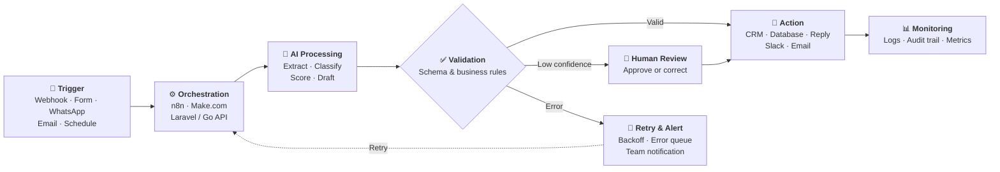

<!-- HERO BANNER -->

  

<!-- ANIMATED VALUE PROPOSITION -->

  

<!-- PRIMARY LINKS -->

  
  
  

 

<!-- ABOUT ME -->
## 👋 About Me

**I help businesses replace slow, manual operations with reliable, AI-powered systems that run on their own.**

I'm an **AI Automation Engineer**. I design and build end-to-end automations that remove repetitive work and connect the tools a business already uses: AI agents for customer support and internal operations, automated approval pipelines, lead capture and enrichment, and real-time sync between CRMs, databases, and apps.

I orchestrate workflows with **n8n, Make.com, Zapier, and GoHighLevel**, and add intelligence with **OpenAI, Claude, Gemini, and LangChain**: classifying requests, drafting replies, extracting data from documents, and making decisions inside the workflow.

Behind that sits **5+ years of production full-stack and backend engineering** in **PHP (Laravel), Go (Gin), and React/Next.js**. When a no-code tool hits its limits, I write the custom API, webhook, or service it needs. Every automation I ship has proper error handling, retries, queues, and data validation, so it keeps working in production instead of breaking quietly.

 

<!-- AT A GLANCE -->
### 📌 At a Glance

<table width="100%">
  <thead>
    <tr>
      <th width="5%" align="center"></th>
      <th width="22%" align="left">Key Area</th>
      <th width="73%" align="left">Details</th>
    </tr>
  </thead>
  <tbody>
    <tr>
      <td align="center">🎯</td>
      <td><strong>Role</strong></td>
      <td>AI Automation Engineer</td>
    </tr>
    <tr>
      <td align="center">🧠</td>
      <td><strong>Specialty</strong></td>
      <td>AI Agents, Workflow Automation &amp; System Integrations</td>
    </tr>
    <tr>
      <td align="center">⚙️</td>
      <td><strong>Automation</strong></td>
      <td>n8n · Make.com · Zapier · GoHighLevel</td>
    </tr>
    <tr>
      <td align="center">🤖</td>
      <td><strong>AI Stack</strong></td>
      <td>OpenAI · Claude · Gemini · LangChain</td>
    </tr>
    <tr>
      <td align="center">💻</td>
      <td><strong>Engineering</strong></td>
      <td>Php (Laravel) · Go (Gin) · React/Next.js</td>
    </tr>
    <tr>
      <td align="center">📈</td>
      <td><strong>Experience</strong></td>
      <td>5+ years in production software</td>
    </tr>
    <tr>
      <td align="center">🟢</td>
      <td><strong>Availability</strong></td>
      <td>Open to full-time roles &amp; freelance projects</td>
    </tr>
  </tbody>
</table>

 

<!-- WHAT I AUTOMATE -->

## ⚡ What I Build & Automate

|     | Capability                          | What I Deliver                                                                                                                                                             | Business Impact                                                                        |
| :-: | :---------------------------------- | :------------------------------------------------------------------------------------------------------------------------------------------------------------------------- | :------------------------------------------------------------------------------------- |
| 🤖  | **AI Agents & Chatbots**            | AI agents for web, WhatsApp, and internal teams that use your live business data to answer questions, qualify leads, draft replies, and take actions in connected systems. | Faster responses, around-the-clock coverage, and less load on support and sales teams. |
| 🔄  | **Operations & Approval Workflows** | Multi-step approval chains, HR and onboarding flows, scheduled reports, and task routing with automatic reminders and escalations.                                         | No manual follow-ups, clear accountability, and fewer delays between steps.            |
| 📈  | **CRM & Sales Automation**          | Lead capture, enrichment, scoring, and nurture sequences in GoHighLevel and other CRMs, with pipelines that update themselves.                                             | Fewer lost leads, consistent follow-up, and accurate pipeline data.                    |
| 📄  | **Document & Data Pipelines**       | AI-assisted extraction, cleaning, and classification of data from emails, PDFs, forms, and websites, delivered to your CRM, Google Sheets, or SQL database.                | Removes manual data entry and the errors that come with it.                            |
| 🔗  | **System Integrations**             | Reliable connections between CRMs, payment gateways, and internal tools using n8n, Make.com, Zapier, webhooks, and custom APIs.                                            | One consistent source of truth, with no copy-paste between apps.                       |
| 🧩  | **Custom Backend Engineering**      | Php (Laravel) and Go (Gin/gRPC) services, Redis queues, and Docker/AWS deployments for the cases where no-code tools are not enough.                                       | Automations that handle real volume and keep running as the business grows.            |

 

<!-- ARCHITECTURE FLOW -->

## 🔄 Production Automation Architecture

A blueprint behind workflow I deliver: AI handles the routine work, built-in safeguards protect your data, and people step in only when it matters.

<table>
  <tr>
    <td width="25%" valign="top"><strong>🛡️ Validated</strong> AI output is checked against schemas and business rules before it reaches any system.</td>
    <td width="25%" valign="top"><strong>👤 Human-in-the-loop</strong> Uncertain or high-impact cases go to a person for approval instead of being guessed.</td>
    <td width="25%" valign="top"><strong>🔁 Fault-tolerant</strong> Retries with backoff, error queues, and alerts mean failures are never silent.</td>
    <td width="25%" valign="top"><strong>📊 Observable</strong> Every run is logged and auditable, so issues are easy to trace and fix.</td>
  </tr>
</table>

 

<!-- TECH STACK (2x2 SYMMETRICAL GRID) -->

## 🛠️ Tech Stack

<table>
  <tr>
    <td width="50%" align="center" valign="top">
      <h4>🤖 AI &amp; Workflow Automation</h4>
      

        
        
        
        
        
        
        
      

    </td>
    <td width="50%" align="center" valign="top">
      <h4>⚙️ Backend &amp; API Engineering</h4>
      

        
        
        
        
        
        
      

    </td>
  </tr>
  <tr>
    <td width="50%" align="center" valign="top">
      <h4>💻 Frontend &amp; Dashboards</h4>
      

        
        
        
        
      

    </td>
    <td width="50%" align="center" valign="top">
      <h4>🗄️ Databases, Cloud &amp; DevOps</h4>
      

        
        
        
        
        
        
      

    </td>
  </tr>
</table>

 

<!-- FEATURED WORK -->

## 🚀 Featured Systems & Projects

<i>A selection of production systems I have designed and built, from AI-powered platforms to the backend infrastructure that keeps them running.</i>

| Project                                                                              | What It Does                                                                                                                                                                | Stack                                        |
| :----------------------------------------------------------------------------------- | :-------------------------------------------------------------------------------------------------------------------------------------------------------------------------- | :------------------------------------------- |
| 💬 **AI Support Agent** WhatsApp &amp; Web Helpdesk                   | Answers customer questions from a company knowledge base and live order data, creates tickets, and hands complex cases to a human with full conversation context.           | `n8n` `OpenAI` `LangChain` `Laravel`         |
| 🎯 **Lead Engine** Capture, Enrich &amp; Qualify                      | Captures leads from forms, ads, and email, enriches them with company data, scores them with AI, and routes qualified leads into GoHighLevel with automated follow-up.      | `GoHighLevel` `Make.com` `Claude` `Webhooks` |
| 📄 **Document Intelligence Pipeline** Invoices, Forms &amp; Contracts | Extracts structured data from PDFs and emails, validates it against business rules, and writes it to Google Sheets or SQL, with low-confidence items sent for human review. | `n8n` `Gemini` `Go` `PostgreSQL`             |
| ✅ **Approval Workflow Engine** Multi-Stage Business Approvals        | Configurable approval chains for purchases, leave, and expenses, with Slack and email actions, reminders, escalations, and a full audit trail.                              | `Laravel` `Redis` `n8n` `Slack API`          |

  👉 Explore full case studies at <a href="https://enamulhossain.com"><strong>enamulhossain.com</strong></a>

 

<!-- ENGINEERING METHODOLOGY (STEP ROADMAP) -->

## 🧭 How I Work

  <b>From manual workflow to reliable, live automation.</b>

<table align="center">
  <tr>
    <td align="center" valign="top" width="22%">
      <h2>🔍</h2>
       
      Find where time &amp; money are lost
    </td>
    <td align="center" valign="middle" width="4%"><h2>➜</h2></td>
    <td align="center" valign="top" width="22%">
      <h2>📐</h2>
       
      Design the system with fixed scope
    </td>
    <td align="center" valign="middle" width="4%"><h2>➜</h2></td>
    <td align="center" valign="top" width="22%">
      <h2>⚡</h2>
       
      AI automation, tested on real data
    </td>
    <td align="center" valign="middle" width="4%"><h2>➜</h2></td>
    <td align="center" valign="top" width="22%">
      <h2>🚀</h2>
       
      Live, monitored &amp; team-ready
    </td>
  </tr>
</table>

  <b>✅ Clear scope</b> &nbsp;·&nbsp; <b>✅ Regular updates</b> &nbsp;·&nbsp; <b>✅ Production-grade</b> &nbsp;·&nbsp; <b>✅ Post-launch support</b>

 

<!-- EXPERIENCE & EDUCATION -->

## 💼 Experience & Education

<table width="100%">
  <thead>
    <tr>
      <th width="22%" align="left">Period</th>
      <th width="28%" align="left">Role</th>
      <th width="50%" align="left">Highlights</th>
    </tr>
  </thead>
  <tbody>
    <tr>
      <td valign="top"><strong>2026&nbsp;–&nbsp;Present</strong></td>
      <td valign="top"><strong>AI Automation Engineer</strong> Independent</td>
      <td valign="top">AI agents, n8n/Make.com workflows, and custom API integrations for businesses.</td>
    </tr>
    <tr>
      <td valign="top"><strong>2023&nbsp;–&nbsp;Present</strong></td>
      <td valign="top"><strong>Software Engineer</strong> Versatilo Group</td>
      <td valign="top">Enterprise HRM platform: approval workflows, KPI dashboards, QR certificate verification, and role-based access.</td>
    </tr>
    <tr>
      <td valign="top"><strong>2022&nbsp;–&nbsp;2023</strong></td>
      <td valign="top"><strong>Backend Developer</strong> Codemen</td>
      <td valign="top">Scalable web applications, REST APIs, and search and performance optimization.</td>
    </tr>
    <tr>
      <td valign="top"><strong>2021&nbsp;–&nbsp;2022</strong></td>
      <td valign="top"><strong>Backend Developer</strong> Rapid IT Ltd</td>
      <td valign="top">Core backend APIs, database design, and third-party integrations.</td>
    </tr>
  </tbody>
</table>

🎓 **B.Sc. in Computer Science & Engineering** · North Western University

 

<!-- GITHUB ANALYTICS -->

## 📊 GitHub Stats

  
  

<!-- 

  

 -->

 

<!-- FOOTER -->

  

    🤝 <b>Need something automated?</b> Email <a href="mailto:enamulhossain79@gmail.com"><b>enamulhossain79@gmail.com</b></a> &nbsp;·&nbsp; message me on <a href="https://wa.me/8801937686568"><b>WhatsApp</b></a> &nbsp;·&nbsp; or visit <a href="https://enamulhossain.com/"><b>enamulhossain.com</b></a>
  

  

