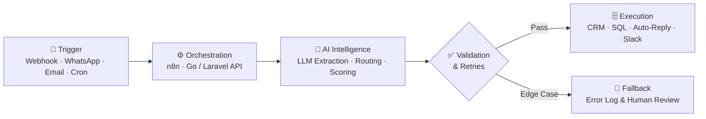

<!-- HERO BANNER -->

  

<!-- ANIMATED VALUE PROPOSITION -->

  

<!-- PRIMARY LINKS -->

  
  
  

 

<!-- ABOUT + AT A GLANCE (2-COLUMN ALIGNED LAYOUT) -->
<table>
  <tr>
    <td width="63%" valign="top">
      <h3>👋 About Me</h3>
      

        <strong>I turn slow, manual business operations into reliable systems that run on their own.</strong>
      

      

        As an <strong>AI Automation Engineer</strong>, I design end-to-end workflows that eliminate repetitive busywork—from AI support and operations agents to automated approval pipelines, lead enrichment systems, and real-time CRM/database syncs.
      

      

        What separates my automations from fragile no-code scripts is what sits underneath: <strong>5+ years of production full-stack and backend engineering</strong> in <strong>PHP (Laravel), Go (Gin), and React/Next.js</strong>. I build automations on clean APIs, queues, retries, and strict validation—so they hold up in real production environments.
      

    </td>
    <td width="37%" valign="top">
      <h3>📌 At a Glance</h3>
      <table>
        <tr>
          <td><strong>Role</strong></td>
          <td>AI Automation Engineer</td>
        </tr>
        <tr>
          <td><strong>Core Focus</strong></td>
          <td>AI Agents, n8n &amp; Custom APIs</td>
        </tr>
        <tr>
          <td><strong>Experience</strong></td>
          <td>5+ Years (Backend → AI)</td>
        </tr>
        <tr>
          <td><strong>Location</strong></td>
          <td>Dhaka, Bangladesh (Remote)</td>
        </tr>
        <tr>
          <td><strong>Status</strong></td>
          <td>🟢 Open to Full-Time &amp; Projects</td>
        </tr>
      </table>
    </td>
  </tr>
</table>

 

<!-- WHAT I AUTOMATE -->
## ⚡ What I Build & Automate

| | Capability | Business Outcome |
| :---: | :--- | :--- |
| 🤖 | **AI Agents & Smart Chatbots** | Context-aware AI agents and WhatsApp/web bots that query live databases, qualify leads, draft accurate replies, and trigger actions in seconds. |
| 🔄 | **Operations & Approval Workflows** | Automated multi-stage approvals, HR/onboarding flows, KPI reporting, and scheduled tasks that eliminate manual follow-ups. |
| 📄 | **Document & Data Pipelines** | Automated extraction, cleaning, classification, and enrichment from emails, PDFs, and web sources straight into your CRM, Sheets, or SQL database. |
| 🔗 | **Cross-App & API Integrations** | Production n8n, Make, Zapier, and custom webhook pipelines connecting payment gateways, CRMs, and internal tools with zero copy-paste. |
| 🧩 | **Production Backend Foundations** | High-throughput Laravel and Go (Gin/gRPC) microservices, Redis queues, and AWS/Docker deployments built to support scale. |

 

<!-- ARCHITECTURE FLOW -->
## 🔄 Production Automation Architecture

 

<!-- TECH STACK (2x2 SYMMETRICAL GRID) -->
## 🛠️ Tech Stack

<table>
  <tr>
    <td width="50%" align="center" valign="top">
      <h4>🤖 AI &amp; Workflow Automation</h4>
      

        
        
        
        
        
        
        
      

    </td>
    <td width="50%" align="center" valign="top">
      <h4>⚙️ Backend &amp; API Engineering</h4>
      

        
        
        
        
        
        
      

    </td>
  </tr>
  <tr>
    <td width="50%" align="center" valign="top">
      <h4>💻 Frontend &amp; Dashboards</h4>
      

        
        
        
        
      

    </td>
    <td width="50%" align="center" valign="top">
      <h4>🗄️ Databases, Cloud &amp; DevOps</h4>
      

        
        
        
        
        
        
      

    </td>
  </tr>
</table>

 

<!-- FEATURED WORK -->
## 🚀 Featured Systems & Projects

| Project | Architecture &amp; Impact | Stack |
| :--- | :--- | :--- |
| 📱 **Gizora — Tech Spec &amp; AI Platform** | Mobile and laptop specification platform powered by AI agents for automated spec ingestion, structured product comparisons, and user assistance. | `Laravel` `Next.js` `AI Agents` |
| 🏢 **Enterprise HRM Automation Suite** | Multi-tenant HRM system featuring multi-stage approval workflows, KPI dashboards, QR-verified certificate pipelines, IT asset linking, and role-scoped financial controls. | `PHP` `Laravel` `MySQL` `REST` |
| ⚡ **Event-Driven Real-Time Backend** | High-concurrency backend architecture utilizing asynchronous queues, pub/sub event routing, and low-latency communication. | `Go` `Gin` `gRPC` `Redis` |
| 🎟️ **oWorld — Events &amp; Offers Platform** | Full-stack discovery platform allowing users to browse, save, and manage local deals and events through a clean REST API. | `Laravel` `React` `MySQL` |
| ☁️ **Automated Cloud Infrastructure** | Containerized cloud setup with automated monitoring, centralized logging, and repeatable deployment workflows. | `AWS` `Docker` `CI/CD` |

  👉 Explore full case studies at <a href="https://enamulhossain.com"><strong>enamulhossain.com</strong></a>

 

<!-- ENGINEERING METHODOLOGY (3-COLUMN EQUAL GRID) -->
## 🧭 How I Work

<table>
  <tr>
    <td width="33.3%" valign="top">
      <h4>01 · Map &amp; Architect</h4>
      
Identify the exact operational bottleneck first, then design clean APIs, webhooks, and schemas built to scale.

    </td>
    <td width="33.3%" valign="top">
      <h4>02 · Build for Reliability</h4>
      
Implement queues, retries, structured logging, and fallback alerts so workflows handle edge cases without silent failures.

    </td>
    <td width="33.3%" valign="top">
      <h4>03 · Automate &amp; Measure</h4>
      
Ship end-to-end AI pipelines that save hours every week, cut human error, and keep business data clean across tools.

    </td>
  </tr>
</table>

 

<!-- EXPERIENCE & EDUCATION -->
## 💼 Experience & Education

| Period | Role &amp; Organization | Key Impact |
| :--- | :--- | :--- |
| **2026 – Present** | **AI Automation Engineer** · Independent / Open to Roles | Designing AI agents, n8n/Make workflow automations, and custom API integrations for modern teams. |
| **2023 – Present** | **Software Engineer** · Versatilo Group | Built enterprise HRM modules including multi-stage approval flows, KPI dashboards, QR certificate verification, IT asset linking, and branch-scoped access controls. |
| **2022 – 2023** | **Backend Developer** · Codemen | Engineered scalable backend web applications, REST APIs, and search/performance optimizations for production platforms. |
| **2021 – 2022** | **Backend Developer** · Rapid It Ltd | Developed core backend APIs, database architectures, and third-party service integrations. |
| **Education** | **B.Sc. in Computer Science &amp; Engineering** | North Western University |

 

<!-- GITHUB ANALYTICS -->
## 📊 GitHub Analytics

  
  

 

<!-- FOOTER -->

  

